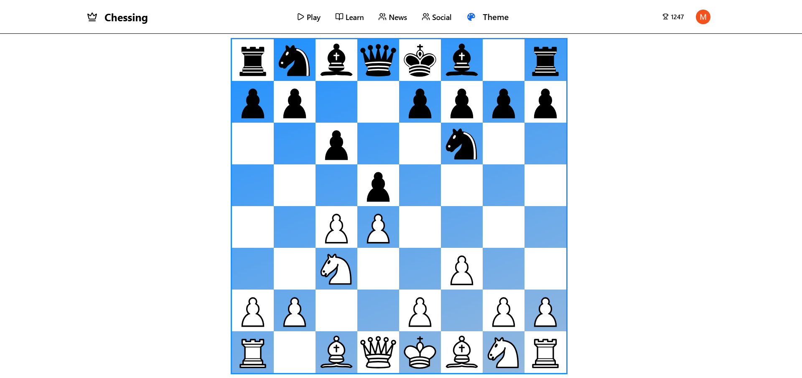
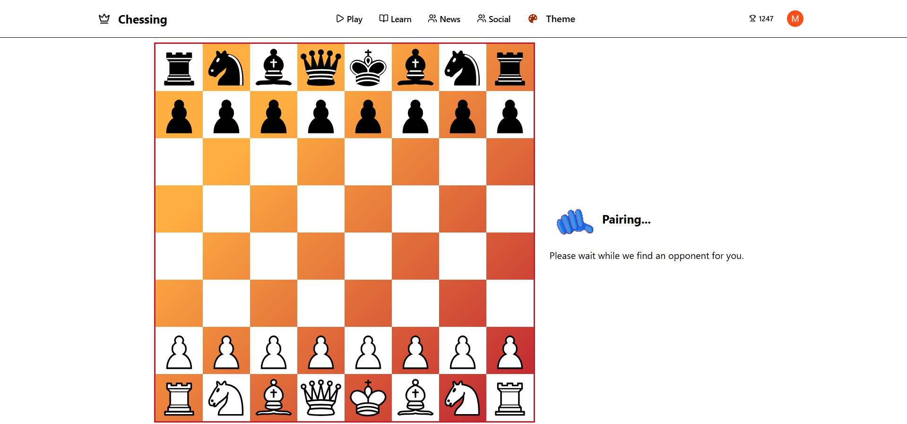

# ♟️ Zugzwang – Distributed Real-Time Chess Platform

A real-time multiplayer chess platform where players can join rooms, get paired with opponents, and play chess live.  
The project focuses on **real-time game synchronization, matchmaking logic, and scalable socket infrastructure**.

---

## Game Board



---

## ✨ Overview

Zugzwang is a full-stack real-time application that allows players to:

- Authenticate and create accounts
- Join a matchmaking queue
- Play chess against other players in real time
- Track match history and move notations
- Explore other players and their games

The project focuses heavily on **backend logic and real-time systems**, while keeping the UI intentionally simple.

---

## 🏗 System Architecture

The application uses a **socket-based real-time architecture**.

1. Players connect to the backend using **Socket.io**.
2. Matchmaking logic pairs players waiting in the queue.
3. Game state and sessions are synchronized through **Redis Pub/Sub**, enabling horizontal scaling across multiple servers.
4. Game data and history are stored in **MongoDB**.

This architecture allows multiple backend instances to coordinate game events.

---

## 🛠 Tech Stack

### Frontend
- **Next.js**
- React
- Drag-and-drop chess interactions

### Backend
- **Node.js**
- **Express**
- **Socket.io**

### Data & Infrastructure
- **MongoDB** – users, games, move history
- **Redis** – Pub/Sub and session state synchronization
- **Clerk** – authentication

### Experimental
- **Three.js** (3D chessboard prototype — currently not used in the production UI)

---

## 🚀 Features

### Multiplayer System
- Real-time gameplay using Socket.io
- Matchmaking queue for pairing players
- Room-based game sessions
- Live move synchronization

### Chess Interaction
- Drag-and-drop chess pieces similar to chess.com
- Move tracking with **standard chess notation**
- Full move history stored for each match

### Player System
- User authentication via Clerk
- Search for other players
- View player profiles
- View games played by other users

### Smart Search
- Debounced player search (500ms delay)
- Search history stored for quick access
- Suggestion system for usernames

### Game Customization
- Change board themes during a match

### Game History
- View previously played matches
- Inspect move list and final board position

---

## Waiting Board



---

## 📂 Project Structure

```
/client
├── pages
├── components
├── utils
└── styles

/server
├── models        # MongoDB schemas
├── routes        # REST APIs
├── sockets       # Socket.io event handling
├── redis         # Pub/Sub & state sync
└── index.js
```

---

## ⚡ Local Setup

### Clone

```bash
git clone https://github.com/Milin2710/chessing.git
cd chessing
```

### Install Dependencies

Server:

```bash
cd server
npm install
```

Client:

```bash
cd client
npm install
```

---

### Environment Variables

Example backend `.env`:

```env
MONGO_URI=mongodb+srv://...
REDIS_URL=redis://localhost:6379
CLERK_API_KEY=your-clerk-key
```

---

### Run the Project

Start redis server, use docker

Start backend:

```bash
cd server
nodemon server
```

Start frontend:

```bash
cd client
npm run dev
```

---

## 📈 Roadmap

- Chess rules engine
- Legal move validation
- Elo rating system
- Spectator mode
- Improved UI
- Mobile optimization

---

## ⚠️ Current Limitations

This project focuses on real-time systems rather than full chess rule enforcement.

Current limitations:

- Chess rules are not fully implemented
- Pieces can be moved to illegal positions
- Move validation is not enforced
- Some matchmaking edge cases can occur when players disconnect during pairing
- 3D board prototype exists but is not integrated into the UI

---

## 🧠 Engineering Highlights

Key aspects implemented in this project:

- Real-time game synchronization using **Socket.io**
- Custom matchmaking and waiting-room logic
- Redis Pub/Sub architecture supporting **horizontal scaling**
- Debounced search system for user discovery
- Move history storage with **standard chess notation**
- Drag-and-drop chess interactions

---

## 🤝 Contributing

Contributions and suggestions are welcome.